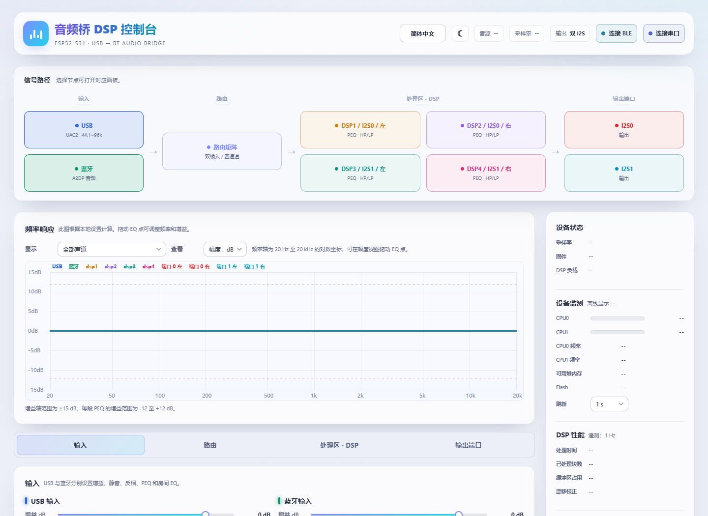

# ESP32-S31 DSP Audio Bridge

**USB 与蓝牙音频输入，四通道 DSP，双 I²S 输出。**

[English](README.en.md) · [硬件接线](docs/HARDWARE.md) · [构建说明](docs/BUILD.md) · [使用限制](docs/LIMITATIONS.md) · [许可范围](LICENSE_SCOPE.md)

> 个人 DIY 实验项目。大量代码由 Codex/GPT、DeepSeek 等人工智能模型在用户指导下编写和修改，未经过独立产品级认证。**不保证功能正常、兼容性、音质、稳定性或安全性，请自行评估并承担使用风险。**
>
> 本项目原创部分仅供非商业用途。第三方代码保留各自许可。本项目是**非商业源码公开项目**，不是符合 OSI 定义的开源软件。

## 功能

| 功能 | 内容与边界 |
| --- | --- |
| USB 音频 | 异步 UAC，支持 44.1～96 kHz、32 位输入 |
| 蓝牙音频 | Classic A2DP；双源有音频时 BT 优先，连接但无音频不等于有效输入 |
| 音频处理 | 输入均衡、路由矩阵、四通道 PEQ/高低通、主音量、限幅、响度、压缩、端口增益与延时 |
| 双 I²S | 两组立体声输出，支持 96 kHz；共享 APLL，不保证两口帧相位对齐 |
| 控制界面 | 完整单文件 HTML，简体中文/English，明暗主题，Web Serial/Web Bluetooth |
| 配置 | 当前配置、五个设备预设、完整配置文件和 DSP 参数文件导入导出 |
| BLE | 调音和配置传输；**不是 LE Audio**，不传 A2DP 音频 |
| 可选 I²C 功放 | core0 运行，JSON 配置与独立存储，TAS5828M/TAS5825M 基础启动与静音模板 |

core0 处理输入、蓝牙解码和控制；core1 处理 DSP、路由和 I²S。core1 源码、共享接口和对象有冻结校验，不能通过重建校验记录掩盖改动。

## 蓝牙编解码器

| 编解码器 | 当前状态 |
| --- | --- |
| SBC / AAC | 有实现与历史播放记录；最新版本未对全部来源和切换组合重新验收 |
| aptX / aptX HD | 有实现与历史播放记录；来源设备是否提供取决于该设备 |
| aptX LL / LC3plus A2DP | 有接口；没有适合音源的组合标记为未验证，不承诺可用 |
| LDAC | 默认不对外启用；曾因 core0 吞吐不足出现 WDT、队列满，不能当作可用功能 |
| LHDC | 已移除支持 |
| aptX Adaptive / Lossless | 不提供，不假设具有专有库或授权 |

能连接蓝牙不代表有音频进入。编解码器源代码许可、专利、商标和产品认证是不同事项；本仓库不授予第三方商业授权，也不保证无需取得其他许可。

## 开始使用

1. 确认硬件是 **ESP32-S31**，不是 ESP32-S3。先阅读接线和电平要求。
2. 下载或复制 [webui/dsp webui.html](webui/dsp%20webui.html)。页面自身不需要其他文件或网络资源。
3. 使用提供 Web Serial 或 Web Bluetooth 的浏览器连接设备。浏览器和系统必须支持相应接口。浏览器若限制本地文件访问，可在可信 localhost 环境打开页面；不要上传到不可信网站代管连接。
4. 先读取配置，再调节参数。保存配置会写设备 NVS；导入文件不自动永久保存。功放配置单独管理，未接 I²C 功放时保持关闭。
5. 从低音量开始。核对采样率、输出格式、路由和功放参数后再连接扬声器。

## 此次发布范围

- 应用源码、配置、冻结记录；单文件 WebUI 及其可编辑源码。
- 已确认许可范围的必要 SDK/组件差异、构建和协议说明。
- **不上传**完整 ESP-IDF、逻辑分析仪工具、采集数据、个人日志、设备地址、凭据、开发环境、旧固件堆和聊天记录。
- 当前在役参考版本为 **0.254**，源快照身份见 [SOURCE_MANIFEST.json](SOURCE_MANIFEST.json)。
- **当前不提供可直接刷写的 BIN/ELF，也不声称这个精简包可独立重建 0.254。** 现有固件链接了 Helix AAC，RPSL 的组合许可要求与本项目非商业许可存在冲突；LDAC 解码库分发许可也未确认。详见 [固件发布状态](firmware/releases/README.md)。免责声明不能解决这些问题。

## 开发与反馈

WebUI 使用 Node.js 内置工具打包：`node webui/build.cjs`。固件需要特定 ESP-IDF fork 和组件修改，不能直接换成标准 ESP-IDF。

提交问题时请提供固件版本、音源、编解码器、采样率、单源/双源场景及最少复现步骤。不要提交配对密钥、个人音乐或完整本机日志。详见 [贡献说明](CONTRIBUTING.md) 和 [安全说明](SECURITY.md)。

## 许可

我们有权许可的原创代码、WebUI 和文档采用 [PolyForm Noncommercial 1.0.0](LICENSE)，禁止未获另行授权的商业用途。其具体允许用途以标准许可原文为准。

第三方原始代码及必须保留原许可的修改不受该非商业许可重新授权。文件内的原始许可、[LICENSE_SCOPE.md](LICENSE_SCOPE.md) 和 [THIRD_PARTY_NOTICES.md](THIRD_PARTY_NOTICES.md) 共同说明范围。保留全部版权与许可通知，不移除第三方要求；公开源代码不等于拥有编解码器专利或商业使用权。

特别感谢 [WillyBilly06/ESP32-S31-A2DP-Codecs](https://github.com/WillyBilly06/ESP32-S31-A2DP-Codecs)、Espressif、TinyUSB、cJSON 和各第三方实现的作者。它们不是本项目的担保方。
